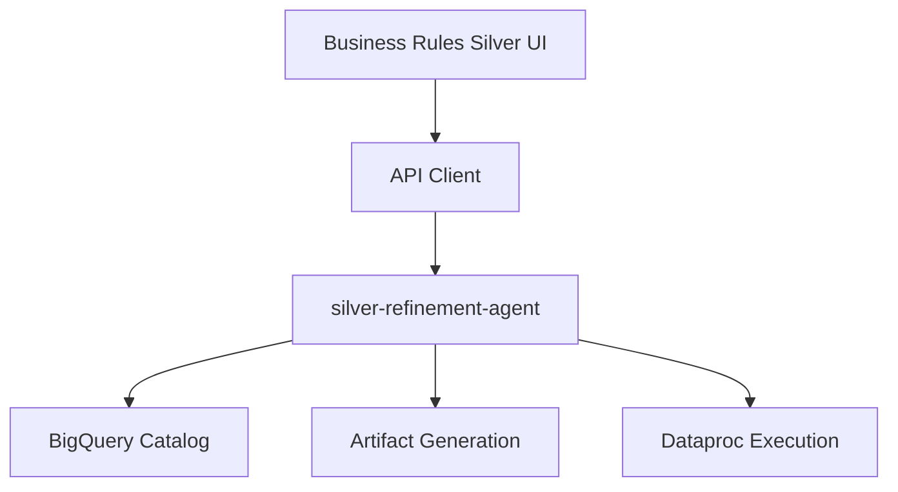

# Arquitectura Frontend - Business Rules Silver

## Objetivo

Construir un frontend separado para operar el flujo Bronze to Silver del backend `silver-refinement-agent`.

## Principios

- No mezclar con el frontend de Cuadratura.
- No inventar estado: usar `SilverWorkflowRecord` como fuente principal.
- Mostrar acciones habilitadas segun `available_actions`.
- Permitir demo sin login.
- Proteger ejecucion Dataproc con confirmacion explicita.

## Stack propuesto

- React
- Vite
- TypeScript
- CSS modular/simple
- Cliente API encapsulado

## Componentes principales

- `AppShell`
- `WorkflowWizard`
- `SourceTargetStep`
- `IncrementalStrategyStep`
- `MappingStep`
- `BusinessRulesStep`
- `ArtifactsStep`
- `ExecutionStep`
- `WorkflowStatusPanel`
- `ArtifactViewer`
- `ErrorBanner`
- `ConfirmDataprocModal`

## Capas frontend

### UI Components

Componentes visuales del wizard y paneles.

### State Management

Estado minimo:

- workflow actual
- metadata catalogo
- mapping editable
- reglas editables
- artefactos
- ejecucion
- errores

### API Client

Encapsula endpoints:

- `silverWorkflowsApi`
- `catalogApi`
- `artifactsApi`
- `executionsApi`

### Domain Mappers

Transforman respuestas backend en modelos UI.

## Backend

Servicio:

- `silver-refinement-agent`

URL validada:

- `https://silver-refinement-agent-mkqutd4koq-uc.a.run.app`

## Modelo de integracion

La UI consume backend directamente en modo demo o mediante proxy/BFF si Cloud Run requiere identidad en despliegue posterior.

## Estados

Workflow:

- `DRAFT`
- `IN_PROGRESS`
- `AWAITING_REVIEW`
- `APPROVED`
- `EXECUTING`
- `SUCCEEDED`
- `FAILED`
- `CANCELLED`

Execution:

- `PENDING`
- `VALIDATED`
- `QUEUED`
- `RUNNING`
- `SUCCEEDED`
- `FAILED`
- `CANCELLED`

## Arquitectura conceptual

## Criterio arquitectonico clave

La UI debe ser un orquestador visual del contrato existente. No debe duplicar reglas de transformacion que ya son responsabilidad del backend.
