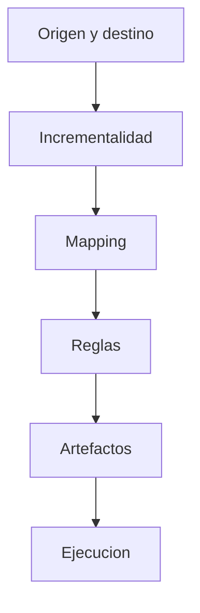

# Flujo UX - Business Rules Silver

## Experiencia

La UI sera un wizard operacional de 6 pasos con panel lateral de estado.

## Panel lateral permanente

Debe mostrar:

- workflow_id
- status
- active_step
- spec_id
- execution_id
- available_actions
- ultima accion ejecutada
- errores recientes

## Paso 1 - Origen y destino

Objetivo: seleccionar fuente Bronze y destino Silver.

Campos:

- Project ID
- Dataset origen
- Tabla origen
- Dataset destino
- Tabla destino
- Crear tabla si no existe

Caso semilla:

- origen: `seguros_bronce.cat_producto`
- destino: `seguros_silver.cat_producto`

Acciones:

- buscar datasets
- buscar tablas
- ver esquema
- crear workflow
- confirmar fuente/destino

## Paso 2 - Incrementalidad y watermark

Objetivo: definir estrategia de carga.

Campos:

- load mode: `FULL` o `INCREMENTAL`
- business key
- watermark column
- deduplicacion

Valores semilla:

- business key: `producto_id`
- watermark: `bronze_fecha_ingesta`
- modo: `INCREMENTAL`

## Paso 3 - Mapping

Objetivo: revisar mapping recomendado y ajustar transformaciones.

Capacidades:

- generar recomendaciones
- editar columna destino
- cambiar tipo destino
- crear campo calculado
- escribir expresion

Ejemplo campo derivado:

```sql
CASE WHEN periodicidad = 'MENSUAL' THEN prima_base * 12 ELSE prima_base END
```

## Paso 4 - Reglas de negocio

Objetivo: generar, editar y aprobar reglas.

Reglas semilla:

- `producto_id` obligatorio.
- `moneda` en `PEN`, `USD`.
- `periodicidad` en `MENSUAL`, `ANUAL`.
- `bronze_estado_registro = RECIBIDO`.
- conservar campos `bronze_*`.
- controlar suma de `prima_base`.

Acciones:

- generar reglas
- guardar draft
- confirmar/aprobar reglas

## Paso 5 - Validacion y artefactos

Objetivo: revisar calidad y generar entregables tecnicos.

Acciones:

- ejecutar quality review
- guardar specification
- generar DDL
- generar paquete
- visualizar artefactos

Artefactos esperados:

- `SILVER_DDL`
- `NOTEBOOK`
- `PYSPARK_SCRIPT`
- `MANIFEST_JSON`
- `SPECIFICATION_JSON`

## Paso 6 - Ejecucion Dataproc

Objetivo: validar paquete, ejecutar y monitorear.

Acciones:

- crear execution
- validar paquete
- abrir confirmacion
- ejecutar Dataproc
- sincronizar estado

Guardrail:

- El boton `Ejecutar Dataproc` siempre debe pedir confirmacion.

## Flujo visual


