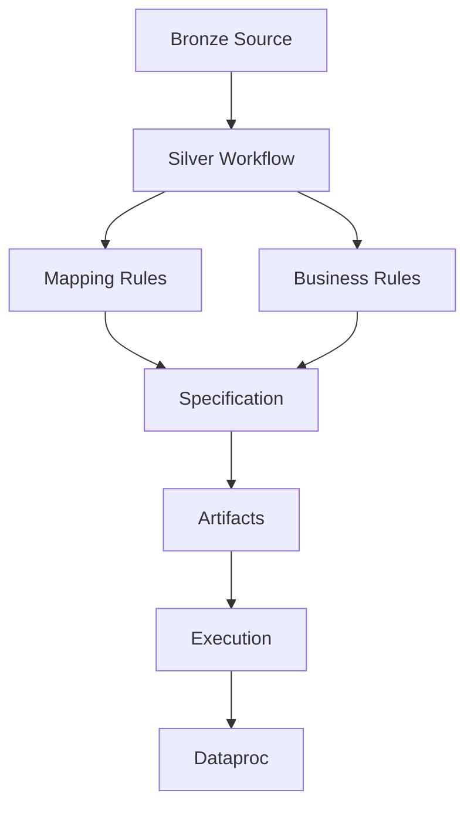

# Modelo de Datos UI - Business Rules Silver

## Proposito

El frontend debe representar y orquestar el modelo necesario para disenar, aprobar, generar y ejecutar reglas Bronze to Silver.

La UI no reemplaza al backend. Visualiza, captura, valida y envia decisiones al backend `silver-refinement-agent`.

## Principio

El software no guarda solo el esquema de una tabla. Debe manejar cuatro capas:

1. Esquema tecnico descubierto.
2. Mapping funcional Bronze to Silver.
3. Reglas de negocio y calidad.
4. Specification, artefactos y ejecucion.

Estas capas se consolidan en `SilverWorkflowRecord` y luego en una specification asociada a `spec_id`.

## SilverWorkflow

Fuente principal de estado del frontend.

Campos backend identificados:

- `workflow_id`
- `version`
- `status`
- `active_step`
- `source`
- `source_confirmed`
- `schema_context`
- `business_rules`
- `mapping_rules`
- `mapping_version`
- `silver_target`
- `quality_rules`
- `quality_review`
- `artifact_package`
- `governance`
- `execution`
- `validation`
- `spec_id`
- `execution_id`
- `available_actions`
- `correlation_id`

## BronzeSourceReference

Representa la tabla origen Bronze.

Caso semilla:

- `project_id`: `proyectopersonal-480420`
- `dataset_id`: `seguros_bronce`
- `table_id`: `cat_producto`

## SilverTargetReference

Representa la tabla destino Silver.

Caso semilla:

- `project_id`: `proyectopersonal-480420`
- `dataset_id`: `seguros_silver`
- `table_id`: `cat_producto`
- `create_if_not_exists`: configurable

## SchemaField

Representa columna descubierta desde BigQuery.

Campos sugeridos UI:

- `name`
- `type`
- `mode`
- `description`
- `usage`
- `is_business_key_candidate`
- `is_watermark_candidate`
- `is_metric_candidate`
- `is_traceability_field`

Columnas semilla:

| Campo | Tipo | Uso |
|---|---|---|
| `producto_id` | `STRING` | Business key |
| `ramo_id` | `STRING` | Dimension |
| `nombre_producto` | `STRING` | Descripcion |
| `moneda` | `STRING` | Regla de dominio |
| `periodicidad` | `STRING` | Regla de dominio/calculo |
| `prima_base` | `NUMERIC` | Metrica de control |
| `bronze_fecha_ingesta` | `TIMESTAMP` | Watermark |
| `bronze_hash_origen` | `STRING` | Trazabilidad |
| `bronze_estado_registro` | `STRING` | Elegibilidad |

## MappingRule

Representa como una columna origen se copia, transforma o deriva hacia Silver.

Campos sugeridos:

- `source_column`
- `target_column`
- `target_type`
- `transformation_type`
- `expression`
- `description`
- `is_required`
- `validation_status`

Tipos UI:

- `DIRECT_COPY`
- `CAST`
- `RENAME`
- `CALCULATED_FIELD`
- `CASE_WHEN`
- `COALESCE`
- `CONCAT`
- `ARITHMETIC_OPERATION`

Ejemplo directo:

```json
{
  "source_column": "prima_base",
  "target_column": "prima_base",
  "target_type": "NUMERIC",
  "transformation_type": "DIRECT_COPY"
}
```

Ejemplo calculado:

```json
{
  "target_column": "prima_base_anualizada",
  "target_type": "NUMERIC",
  "transformation_type": "CASE_WHEN",
  "expression": "CASE WHEN periodicidad = 'MENSUAL' THEN prima_base * 12 ELSE prima_base END"
}
```

## BusinessRule

Representa regla funcional aprobable.

Campos sugeridos:

- `rule_id`
- `name`
- `description`
- `rule_type`
- `target_column`
- `expression`
- `severity`
- `status`

Reglas semilla:

1. `producto_id` obligatorio y business key.
2. `bronze_fecha_ingesta` como watermark incremental.
3. `prima_base` debe conservarse y cuadrar por SUM.
4. `moneda` solo permite `PEN` o `USD`.
5. `periodicidad` solo permite `MENSUAL` o `ANUAL`.
6. `bronze_estado_registro` debe ser `RECIBIDO`.
7. Campos `bronze_*` deben conservarse.
8. `prima_base_anualizada` puede generarse como campo derivado.

## WatermarkStrategy

Define incrementalidad.

Campos:

- `load_mode`: `FULL` o `INCREMENTAL`
- `watermark_column`
- `business_key`
- `deduplication_enabled`
- `last_processed_value`

Caso semilla:

- `load_mode`: `INCREMENTAL`
- `watermark_column`: `bronze_fecha_ingesta`
- `business_key`: `producto_id`

## ArtifactPackage

Representa artefactos generados.

Tipos identificados:

- `SILVER_DDL`
- `SPECIFICATION_JSON`
- `MAPPING_JSON`
- `TRANSFORMATIONS_JSON`
- `README`
- `MANIFEST_JSON`
- `PYSPARK_SCRIPT`
- `NOTEBOOK`
- `ARTIFACT_PACKAGE`

## Execution

Representa ejecucion tecnica.

Estados:

- `PENDING`
- `VALIDATED`
- `QUEUED`
- `RUNNING`
- `SUCCEEDED`
- `FAILED`
- `CANCELLED`

El boton `Ejecutar Dataproc` debe invocar submit solo despues de validar paquete y recibir confirmacion del usuario.

## Relacion conceptual


